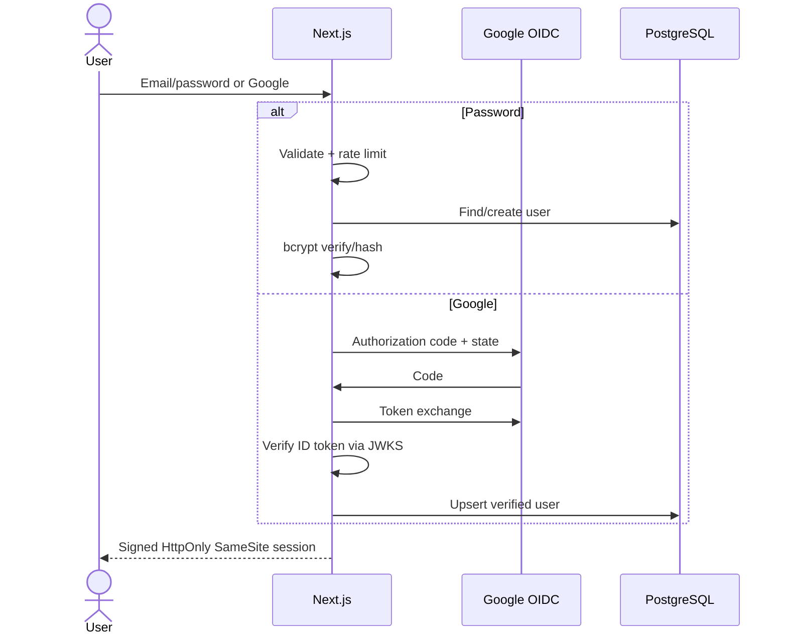
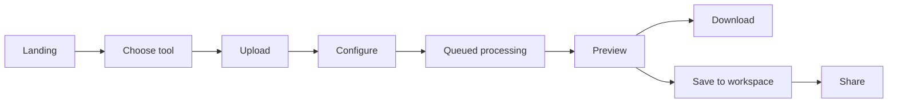
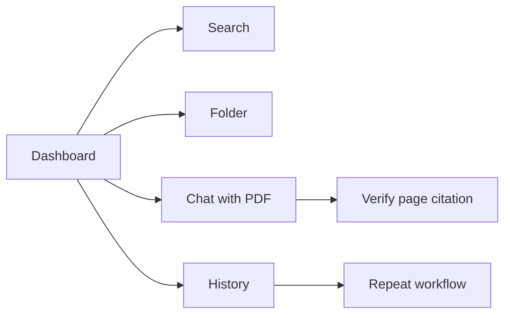
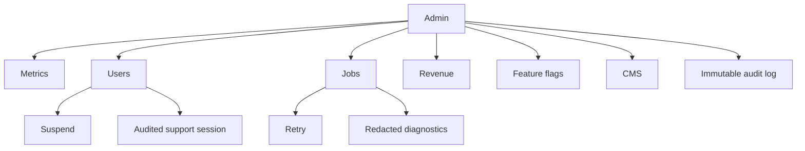

# iCanPDF Product & Technical Architecture

## 1. Product architecture

iCanPDF is organized into four surfaces:

1. **Public acquisition** — SEO landing page, one indexable route per tool, pricing, blog, help, trust, and company pages.
2. **Document workspace** — files, folders, favorites, search, trash, activity, conversion history, AI history, notifications, storage, billing, and profile settings.
3. **Processing platform** — upload orchestration, idempotent jobs, queue workers, document engines, AI/RAG services, isolated storage, webhooks, and scheduled deletion.
4. **Operations console** — users, subscriptions, jobs, files, analytics, revenue, support, audit logs, CMS, SEO controls, and feature flags.

The Next.js application is the web/BFF layer. Long-running PDF work belongs in stateless workers behind a durable queue; the web process never performs CPU-heavy conversion synchronously.

## 2. Folder structure

```text
src/
  app/
    api/auth/                 Authentication route handlers
    dashboard/                Authenticated workspace
    tools/[slug]/             Statically generated tool pages
    admin/                    Operations console
    settings/                 Account and security settings
    [slug]/                   First-party content pages
    sitemap.ts robots.ts      Technical SEO
  components/                 Reusable product and marketing UI
  db/
    index.ts                  Pooled Drizzle client
    schema.ts                 PostgreSQL source of truth
  lib/
    session.ts                Signed session boundary
    rate-limit.ts             Endpoint abuse protection
    tools.ts                  Typed tool registry
    site.ts                   Canonical brand metadata
public/images/                Optimized first-party media
docs/                         Product and operational documentation
```

Recommended scale-out packages:

```text
services/
  orchestrator/               Job dispatch, retries, quotas
  pdf-worker/                 LibreOffice, qpdf, Ghostscript, PDFium
  ocr-worker/                 OCR and handwriting/table recognition
  ai-worker/                  Chunking, embeddings, RAG, citations
packages/
  contracts/                  API schemas and event contracts
  observability/              Logs, traces, metrics
  storage/                    Signed upload/download abstraction
```

## 3. Database schema

Implemented tables:

- `users`: identity, provider linkage, plan, locale, theme, storage quota, admin flag, soft deletion.
- `sessions`: revocable hashed sessions and device context.
- `folders`: hierarchical user organization.
- `files`: storage key, checksum, type, page count, status, metadata, favorites, expiry, soft deletion.
- `processing_jobs`: tool, options, input/output, progress, state, timestamps, and errors.
- `ai_conversations` / `ai_messages`: persistent document chats with page citations and usage.
- `subscriptions`: provider references, plan lifecycle, period end, and cancellation.
- `notifications`: durable in-app notification inbox.
- `audit_logs`: actor/action/entity/context trail for security and administration.

Production additions: organization memberships, roles, signature envelopes, form templates, share links, API keys, webhooks, coupons, referrals, support tickets, feature flags, CMS entries, usage ledger, and legal-hold policies.

## 4. API design

Current routes:

- `GET /api/health`
- `POST /api/auth/signup`
- `POST /api/auth/login`
- `POST /api/auth/logout`
- `GET /api/auth/google`
- `GET /api/auth/google/callback`

Versioned production contract:

- `POST /api/v1/uploads` → signed multipart upload
- `POST /api/v1/files` → finalize upload/checksum
- `GET /api/v1/files?cursor=` → paginated file search
- `PATCH /api/v1/files/:id` / `DELETE /api/v1/files/:id`
- `POST /api/v1/jobs` with idempotency key
- `GET /api/v1/jobs/:id` → state/progress/result
- `POST /api/v1/jobs/:id/cancel`
- `POST /api/v1/conversations` / `POST /api/v1/conversations/:id/messages`
- `POST /api/v1/shares` / `DELETE /api/v1/shares/:id`
- `POST /api/v1/signature-envelopes`
- `POST /api/v1/billing/checkout`
- `POST /api/v1/webhooks/payments`
- `GET /api/v1/admin/metrics`

All writes use runtime schemas, authorization checks, rate limits, idempotency, request IDs, and structured errors. Jobs publish progress events to Redis streams; SSE or WebSocket gateways fan updates to clients.

## 5. Authentication flow



Password-reset responses never reveal account existence. Production reset and verification tokens are random, single-use, hashed in the database, short-lived, and invalidated after password changes. Middleware protects workspace/admin routes, while every handler still performs resource-level authorization.

## 6. User flows





## 7. Admin flow



Admin access requires MFA, short sessions, explicit RBAC, IP/device anomaly alerts, and audit logging. Sensitive document contents are unavailable to normal support roles.

## 8. UI/UX system

- Mobile-first shell with 44px minimum targets, keyboard focus rings, reduced-motion support, semantic headings, and WCAG-aware contrast.
- Deep navy/cobalt identity, contextual pastel tool colors, rounded 12–28px geometry, restrained glass effects, and progressive disclosure.
- Shared loading, empty, error, success, upload, processing, and cancellation states.
- Dark/light themes use CSS tokens, persist locally, and initialize before paint.
- Dashboard prioritizes quick actions, recency, storage confidence, and transparent task status.

Responsive breakpoints: compact phone (320+), phone (480+), tablet (768+), laptop (1024+), desktop (1280+), wide operations view (1440+). Tables gain horizontal scroll or card transformations at narrow widths.

## 9. Processing architecture

1. Client requests a signed upload and sends chunks directly to object storage.
2. API verifies checksum/type/limit, creates file and job records in one transaction, then enqueues a small message.
3. Worker claims the job with a visibility timeout, downloads to an isolated ephemeral volume, scans it, and invokes the appropriate engine.
4. Progress is emitted as events and persisted at coarse intervals.
5. Output is scanned, checksummed, stored, and attached atomically.
6. The client receives completion via SSE/WebSocket and a short-lived signed download.
7. Lifecycle rules remove temporary objects; a reconciler handles abandoned uploads and stalled jobs.

Use separate pools/queues for interactive, batch, OCR, and AI work. Enforce CPU, memory, duration, page, and decompression limits. Retries are bounded and only applied to safe error classes.

## 10. Deployment

Local:

1. Copy `.env.example` to `.env` and set `AUTH_SECRET`.
2. Start PostgreSQL and create `app_db`.
3. Run `npm install`.
4. Run `npx drizzle-kit push`.
5. Run `npm run dev`.

Production:

1. Deploy the Next.js container behind HTTPS/CDN with immutable static assets.
2. Use managed PostgreSQL with PITR, connection pooling, encryption, private networking, and replica strategy.
3. Use private object storage with CORS restricted to the application origin and signed URLs.
4. Deploy Redis/queue and autoscaled worker pools independently.
5. Configure Google’s exact callback URL: `/api/auth/google/callback`.
6. Run schema migrations as a gated release job before shifting traffic.
7. Verify `/api/health`, run smoke tests, then use canary or blue/green traffic shifting.

## 11. Environment configuration

Required: `DATABASE_URL`, `AUTH_SECRET`, `NEXT_PUBLIC_APP_URL`.
Google login: `GOOGLE_CLIENT_ID`, `GOOGLE_CLIENT_SECRET`.
Scale services: object-storage credentials, `REDIS_URL`, transactional email, AI provider, payments, error monitoring, and telemetry exporters. Secrets belong in the deployment secret manager, never client bundles or source control.

## 12. Testing strategy

- Unit: validators, authorization policies, quota math, tool option builders, storage abstractions.
- Component: keyboard navigation, upload states, forms, errors, dark mode, responsive behavior.
- Integration: auth, Drizzle repositories, job transitions, webhooks, signed URLs, idempotency.
- End-to-end: sign-up → upload → process → download; subscription; share expiry; delete/restore; admin retry.
- Contract: worker events, payment webhooks, AI citation schema.
- Security: SAST, dependency scanning, secret scanning, DAST, upload fuzzing, archive bombs, PDF parser corpus.
- Performance: Web Vitals budgets, k6 API tests, queue saturation, large-file and batch soak tests.
- Accessibility: axe in CI plus manual keyboard and screen-reader passes.

## 13. Performance plan

- Static generation for tool/content pages; server rendering only when personalization is needed.
- Route-level code splitting, client components only for interaction, image optimization, font self-hosting.
- Cursor pagination, indexed queries, prepared statements, read replicas for analytics.
- CDN caching for public pages; tagged invalidation for CMS; private `no-store` for user data.
- Direct multipart uploads, streaming downloads, resumability, thumbnails generated asynchronously.
- Queue backpressure, autoscaling on age/depth, priority lanes, per-tenant concurrency controls.
- Bundle, LCP, CLS, INP, job latency, and failure-rate budgets enforced in CI/observability.

## 14. Security checklist

- [x] Parameterized Drizzle queries and strict TypeScript boundaries
- [x] Password hashing and signed HTTP-only, SameSite sessions
- [x] OAuth state and cryptographically verified Google ID tokens
- [x] Basic auth rate limiting and non-enumerating recovery UX
- [x] Input size/type checks in interactive upload surfaces
- [ ] Distributed Redis rate limits and bot controls
- [ ] CSRF token for cross-site-sensitive mutations beyond SameSite protection
- [ ] Malware/CDR pipeline and sandboxed parsing workers
- [ ] KMS envelope encryption, key rotation, and tenant-scoped storage paths
- [ ] Organization RBAC, admin MFA, session revocation, device management
- [ ] Immutable audit export and SIEM alerts
- [ ] CSP, HSTS, Permissions-Policy, and production security headers
- [ ] Independent penetration test and incident-response exercises
- [ ] Backup restore drills, RPO/RTO verification, and legal retention controls

## 15. SEO strategy

Every tool has a stable canonical URL, unique title/description, breadcrumb context, WebApplication schema, explanatory content, related links, and share metadata. `sitemap.xml` includes all tools and first-party pages. `robots.txt` excludes private/admin/API routes. Continue with CMS-authored expert guides, localized hreflang clusters, FAQ schema where eligible, image OG variants, programmatic broken-link checks, and Search Console/Core Web Vitals monitoring.

## 16. Delivery plan and roadmap

**Phase 1 — Foundation:** identity, uploads, file model, conversion/compression/merge/split, workspace, subscriptions, telemetry.

**Phase 2 — Advanced documents:** visual editor, organize canvas, OCR languages, forms, signatures, scanner, sharing, batch queues.

**Phase 3 — Intelligence:** citation-based chat, summaries, translation, notes, flashcards, extraction, tenant-safe retrieval, evaluation harness.

**Phase 4 — Teams:** organizations, RBAC, SSO/SCIM, audit exports, retention, data residency, admin controls, API/webhooks.

**Phase 5 — Ecosystem:** desktop/mobile capture, Drive/Dropbox/OneDrive integrations, workflow automation, templates, marketplace, regional processing.

Success metrics: activation to first completed job, job success/latency, D7/D30 retention, free-to-paid conversion, expansion revenue, support contacts per 1,000 jobs, AI citation acceptance, and document deletion SLA compliance.
